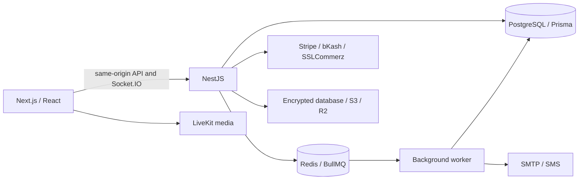

# Careflow architecture

The original brief is [Project_spec.md](Project_spec.md). The repository has two application folders: `frontend` and `backend`. Each has its own package manifest, lockfile, configuration and documentation. Docker Compose and operational scripts live in `backend`.

## Runtime

Next proxies `/api` to Nest. HTTP-only cookies contain access and opaque refresh credentials. TanStack Query owns server data; Zustand stores the temporary booking hold. Socket.IO carries updates and polling provides a fallback. LiveKit media travels directly between the browser and the configured video server.

## Scheduling and booking

DAILY, WEEKLY and MONTHLY RRULEs support intervals and ordinal weekdays. Recurrence expands in the clinic IANA timezone, with UTC instants persisted. Buffers, effective dates, custom hours, day-off dates and recurring block series affect virtual slots. Blocks can be removed for one occurrence or that occurrence and its future series. Archived availability can be restored.

Doctor-wide PostgreSQL advisory locks serialize holds, confirmations, rescheduling and relevant state changes across clinics. Sorted doctor locks precede sorted room locks. PostgreSQL range exclusion constraints independently reject overlapping active doctor and room appointments, including overlaps with different start times. A partial unique index also protects active exact starts. Holds expire after three minutes; transactions revalidate expiry, ownership and current availability before consuming them. Expired holds never require a worker to become bookable again. Available slots are generated rather than stored or cached, so schedule changes take effect immediately.

The held quote freezes consultation fee, add-ons, tax and refund/pay-later policy. Confirmation atomically creates the appointment, immutable numbered invoice, payment, telemedicine session when needed, audit and notification outbox. Idempotency keys survive retries. Pay-first clinics retain PENDING_PAYMENT for at most 15 minutes; confirmed provider capture completes confirmation. A verified late capture on a cancelled visit enters the refund workflow.

Schedule impact preview runs inside a transaction that deliberately rolls back. Actual edits retain existing bookings and persist conflict-review flags. Calendar dragging uses the same real hold/reschedule flow. Shared rooms have capacity one. Rescheduling links the original and replacement; each has a separate invoice and the original follows its quoted refund policy.

## Clinic operations

Daily clinic ticket numbers come from atomic counters. Queue priority, check-in time and consultation timestamps support call-next, waiting/consulting/completed lanes and patient queue positions. A doctor can have one consultation in progress across clinics. Clinical and administrative permissions remain distinct. Doctor utilization compares booked and scheduled minutes over the last seven clinic-local dates; overlapping windows count once. Waiting time measures check-in to consultation start.

Clinic administration manages registered users by email, doctor assignment, rooms, fees, services and billing policies. Super administrators manage user activation, feature flags and audited platform operations. Patient and staff overview screens show different operational content.

## Clinical records

SOAP notes retain prior revisions. A PostgreSQL trigger maintains full-text search data, including existing notes. Search first authorizes the requested patient/clinic and restricts matching rows to authorized encounters. Treating relationships scope history; cross-clinic history requires the patient's general consent or a live, doctor-specific, expiring grant. This implementation does not collect national ID hashes.

Reusable private/shared SOAP templates, care plans and task completion, laboratory order/sample/result/review transitions and referrals are persisted. Only the assigned clinician can review laboratory results; clinic nurses can collect samples/upload results through the API. Receiving doctors accept referrals. Patients see their own plans, results and referrals.

Prescriptions use structured medication items, a separate Argon2-hashed six-digit doctor PIN, immutable signed content, revocation/expiry, PDF artifacts and QR verification. PIN setup requires the doctor's password; signing requires a configured PIN outside demo mode. The server HMAC and static drug-interaction example are demonstration mechanisms, not regulated signatures or a clinical decision system. Public verification discloses prescriber/license, clinic, signing date and status, without patient identity or medications.

Attachments accept PDF, PNG and JPEG up to 5 MB after file-signature validation. AES-256-GCM encryption binds ciphertext to the appointment. Storage defaults to PostgreSQL; S3/R2 stores the same client-encrypted bytes when configured. Object names contain random identifiers rather than patient names. Downloads and care-history exports require authorization and create audit records. Preserve encryption keys alongside backups. Antivirus scanning and FHIR interoperability are outside this implementation.

## Authentication and delivery

Passwords use Argon2id. Access tokens expire after 15 minutes and bind to an active database session, making revocation effective on subsequent API requests. Refresh tokens rotate once per use. Socket connections join their session room, expire with their token and are disconnected on device revocation. Password changes/resets revoke all devices. OTPs are HMAC-hashed, expire after five minutes and are purpose-bound with limited guesses. Phone login requires prior verification. Demo mode returns a labelled local challenge code; real email/SMS requires transports.

Notification preferences control in-app/email/SMS channels, reminders and follow-ups. Transactional outbox records survive booking/clinical transaction rollback and drive retryable delivery. Delivery is at least once; external channels can duplicate a message after a crash between send and acknowledgement. Workers repair missing jobs, send T-24h/T-2h/T-15m reminders and post-visit follow-ups, expire holds/OTPs/sessions/prescriptions, enforce clinic no-show grace, offer waitlist openings, materialize PDFs, reconcile captures/refunds and close LiveKit rooms. Offers do not reserve slots. The administrator job monitor exposes operational metadata and safe retries, without clinical payloads.

## Finance and provider configuration

Capture and cumulative refund journals balance cash, consultation revenue and tax accounts. Repeated settlement/refund callbacks do not duplicate journal entries. Finance provides revenue trends, outstanding and pending refunds, numbered invoice downloads, service and tax configuration, reconciliation runs and audited CSV exports with formula escaping. Dashboard payment lists are capped at 500 recent rows, ledger displays at 1000; ledger balance aggregates all rows. Reconciliation scans up to 500 payments from the last 30 days per run. It reconciles captures/refunds, not provider bank payouts or merchant fees.

| Provider    | Configuration                                                                           | Verification boundary                                                                                         |
| ----------- | --------------------------------------------------------------------------------------- | ------------------------------------------------------------------------------------------------------------- |
| Demo        | DEMO_MODE=true, PAYMENT_PROVIDER=demo                                                   | Local settlement only; never moves money                                                                      |
| Stripe      | STRIPE_SECRET_KEY, STRIPE_WEBHOOK_SECRET, frontend NEXT_PUBLIC_STRIPE_PUBLISHABLE_KEY   | Signed raw-body webhooks, amount/currency verification, idempotent intent/refund operations                   |
| bKash       | BKASH_USERNAME, BKASH_PASSWORD, BKASH_APP_KEY, BKASH_APP_SECRET, BKASH_BASE_URL         | Tokenized v1.2 checkout/create/execute/query/refund contract; merchant API version must match configured base |
| SSLCommerz  | SSLCOMMERZ_STORE_ID, SSLCOMMERZ_STORE_PASSWORD, SSLCOMMERZ_SANDBOX                      | Hosted checkout, server order validation, risk checks, IPN, asynchronous refund polling                       |
| LiveKit     | LIVEKIT_URL, LIVEKIT_API_KEY, LIVEKIT_API_SECRET, TELEMEDICINE_PROVIDER=livekit         | Timed participant-only tokens, doctor admission, media controls and room closure                              |
| Email / SMS | SMTP_URL, SMTP_FROM; SMS_API_URL, SMS_API_KEY                                           | Generic bearer-auth JSON SMS gateway contract; adapt to the selected vendor                                   |
| S3 / R2     | S3_BUCKET, S3_REGION, S3_ENDPOINT, S3_ACCESS_KEY, S3_SECRET_KEY, optional S3_KMS_KEY_ID | Client-side encrypted documents; optional provider KMS layer                                                  |

Payment returns never trust browser status. The backend verifies the receipt before settlement. Hosted checkout redirects allow only HTTPS provider domains. Configure a public HTTPS APP_URL for merchant callbacks. Demo transports support local workflows; live video, object storage, financial transactions and delivery were not exercised against merchant accounts. Transport contract mocks and PostgreSQL integration tests do not replace merchant sandbox acceptance tests. bKash credentials/API-version access require merchant-specific validation before enabling live checkout.

Telemedicine supports a timed waiting room, doctor admission, browser microphone/camera controls and persisted participant-only consultation chat. Chat writes require an open room during the visit window. Recording is disabled; the consent flag does not start recording.

## Running and validating

Follow [backend setup](../README.md) and [frontend setup](../../frontend/README.md). API health checks PostgreSQL and Redis. Each application installs independently. Backend dev watches TypeScript and restarts the compiled API; frontend uses the supported Webpack mode. A Dockerfile-specific ignore file excludes local dependencies, configuration secrets and artifacts from each build context.

The suite includes PostgreSQL race/room constraints, recurrence/DST, quote stability, queue ownership, clinical permissions, expiring consent, purpose-bound OTPs, immediate session revocation, provider transport contracts, verified capture, pending refunds, balanced cumulative journals and transactional notification preferences. Browser journeys cover patient booking/payment/cancellation, clinical PDF and consultation, registration/settings, advanced calendar/queue/schedule preview, care tasks/results, finance/CSV/jobs and mobile minimum-font/overflow checks.

GitHub only discovers workflows in root `.github/workflows`; `backend/ci/workflows/ci.yml` is a template because this repository intentionally has only two root folders. Run `npm run check:all -- --browser` from backend or configure an external CI job.

Replace example keys, disable demo mode and configure TLS/CORS for public deployment. Production startup rejects demo mode and requires authentication secrets. Back up PostgreSQL, Redis and document encryption keys; validate restoration. This portfolio implementation makes no regulatory certification claim.

## Primary references

- [Prisma interactive transactions](https://www.prisma.io/docs/orm/prisma-client/queries/transactions)
- [PostgreSQL range exclusion constraints](https://www.postgresql.org/docs/current/rangetypes.html#RANGETYPES-CONSTRAINT)
- [FullCalendar React integration](https://fullcalendar.io/docs/react)
- [SSLCommerz developer documentation](https://developer.sslcommerz.com/)
- [Stripe webhook signature verification](https://docs.stripe.com/webhooks/signature)
- [LiveKit room access tokens](https://docs.livekit.io/home/get-started/authentication/)
