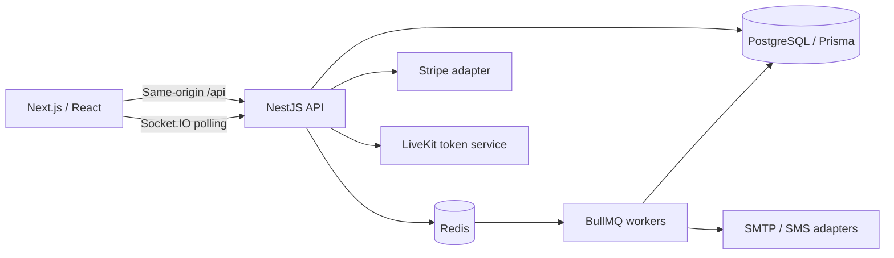

# Careflow architecture

Careflow is a runnable multi-clinic healthcare portfolio application. `Project_spec.md` is the original brief; this document describes the implementation and its boundaries.

## Data flow

Next serves the App Router application and proxies `/api` to Nest. Browser authentication uses HTTP-only cookies. TanStack Query owns server data; Zustand owns the temporary slot hold. LiveKit browser media travels to the configured LiveKit server, independently of Nest.

## Booking correctness

Availability is virtual. Weekly rules are expanded in the clinic's IANA timezone using Luxon. Day-off exceptions remove the date, custom windows replace hours, and block windows remove overlapping candidates. Existing bookings and unexpired holds across every clinic make a doctor unavailable.

Every hold, confirmation, reschedule, cancellation, and payment settlement takes a PostgreSQL transaction advisory lock for the doctor. Doctor-wide locks deliberately serialize different start times and clinics so overlapping windows cannot slip through separate exact-start locks. Multi-doctor rescheduling sorts lock keys to avoid deadlocks. A partial unique index protects active `(doctorId, startAt)` records as an additional database invariant.

Confirmation validates ownership, TTL, current schedule, and availability again inside the lock. It consumes the hold, creates the appointment/payment/telemedicine session, and records an audit event atomically. Booking idempotency keys are durable. Expired holds are ignored by slot queries and replaced on the next hold, so correctness does not depend on the cleanup worker running.

Rescheduling creates a linked appointment and transitions the original to `RESCHEDULED`. The original payment follows the cancellation refund policy; the replacement receives a separate invoice. The shipped booking policy permits payment after confirmation.

## State and authorization

Explicit transition tables reject illegal changes with HTTP 409. Access tokens expire after 15 minutes. Opaque refresh tokens are hashed, stored per device, and consumed once during rotation. Passwords use Argon2id. Email OTPs expire after five minutes and permit five guesses; codes are HMAC-hashed. Demo mode returns an explicitly labelled code for local testing.

Clinic memberships are checked against the database on every authenticated request. Administrative rights in one clinic do not grant rights in another. Patients see their own appointments; treating doctors see their visits. Clinic administrators and receptionists manage booking metadata. Nurses enter vitals. Receptionists and clinic administrators do not receive clinical notes or prescriptions merely because they can manage bookings.

Treating doctors can retrieve a patient's history within a clinic where a treating relationship exists. Cross-clinic retrieval requires the patient's `consentHistory` flag. This implementation deliberately does not collect or match national IDs. Public prescription verification returns status, prescriber/license, clinic and signing date; it does not return patient names or medications.

## Documents and jobs

SOAP edits preserve the previous note as a revision and update a PostgreSQL full-text index. Signed prescriptions cannot be edited. A demonstration server HMAC seals their contents; it is not a regulated digital signature. PDFs include a QR verification URL. Signed PDFs are materialized by a durable BullMQ job and can also be generated immediately on authenticated download.

Attachments accept PDF, PNG, and JPEG up to 5 MB with file signature checks. AES-256-GCM encrypts the data with an independent deployment key and appointment-bound additional authenticated data. Metadata and ciphertext are stored in PostgreSQL. S3/R2 offloading is a future adapter; database backups and encryption-key backups must be managed together. Files are served as authenticated attachments, not public executable content. Antivirus scanning is not included.

Workers run within the API process. Redis persists delayed reminder jobs, retry state, and job IDs. The periodic database scan repairs missing PDF/refund work, expires holds/OTPs/sessions/prescriptions, marks no-shows after a 30-minute grace period, and offers cancelled slots to matching waitlist entries. Offers are notifications and do not reserve a slot. Email and SMS require configured transports; in-app notifications work locally. Queue failures log only job names, without note bodies, prescriptions, email addresses or phone numbers.

## Provider boundaries

| Capability         | Delivered behavior                                                                                                      | External requirement / boundary                                                                                        |
| ------------------ | ----------------------------------------------------------------------------------------------------------------------- | ---------------------------------------------------------------------------------------------------------------------- |
| Payments           | Demo settlement, Stripe Payment Intents, signed webhook verification, event deduplication, idempotent refunds, invoices | Stripe account/keys and a supported merchant currency; no live financial transaction was performed during verification |
| bKash / SSLCommerz | Provider factory fails explicitly when selected                                                                         | Merchant-specific adapters are not implemented                                                                         |
| Video              | Patient/doctor-only LiveKit grants, timed room access, waiting/admission/end flow, browser audio/video controls         | LiveKit server and credentials; demo mode provides the waiting-room flow without video                                 |
| Reminders          | T-24h/T-2h/T-15m delayed jobs and in-app reminders                                                                      | SMTP and optional bearer-auth JSON SMS gateway; phone OTP, push and post-visit follow-up are not implemented           |
| Prescriptions      | Structured medications, draft/sign/revoke/expire, static interaction example, persisted PDF, QR verification            | Signature and interaction checker are portfolio demonstrations                                                         |
| Scheduling         | Weekly BYDAY recurrence, buffers, time off/custom/block exceptions, conflict count                                      | Capacity is one per doctor; no general RRULE parser, recurring block series editor, or room capacity locking           |
| Analytics          | Counts, net paid revenue, no-show/completion rates, activity chart, late check-in average                               | Late arrival is not measured waiting-room duration; provider payout reconciliation is not implemented                  |
| Platform           | Multi-clinic roles, rooms, doctor assignment, feature flags, soft user deactivation, audit records                      | No certification or claim of compliance with a healthcare regulatory framework                                         |

## Operational notes

- Use a TLS reverse proxy and exact CORS origins for a public deployment. Demo data, demo settlement and OTP disclosure must be disabled outside a demonstration environment.
- Replace every example secret. `npm run setup` creates independent random keys for a fresh checkout. Production startup rejects demo mode and requires 32-character authentication secrets.
- Revoking a device prevents further refresh; a previously issued access token can remain valid for up to 15 minutes. User deactivation is checked on every API request.
- Preserve database and Redis volumes. Back up the database, attachment encryption key, and provider configuration. Test restoration before using meaningful data.
- Redis must be available for API rate limiting and jobs. The health route checks both Redis and PostgreSQL.
- The default rate limit is shared by source IP. Configure a trusted reverse-proxy IP policy before scaling traffic; arbitrary forwarded headers are not trusted.
- Production video, Stripe, SMTP and SMS transports require separate end-to-end validation using the operator's own credentials. Automated tests cover their local contracts and signed tokens/webhooks.

## Reference documentation

The framework setup follows [Next.js App Router installation](https://nextjs.org/docs/app/getting-started/installation). Transaction boundaries follow [Prisma interactive transactions](https://www.prisma.io/docs/orm/v6/prisma-client/queries/transactions). Request authorization is built with [NestJS guards](https://docs.nestjs.com/security/authorization).
