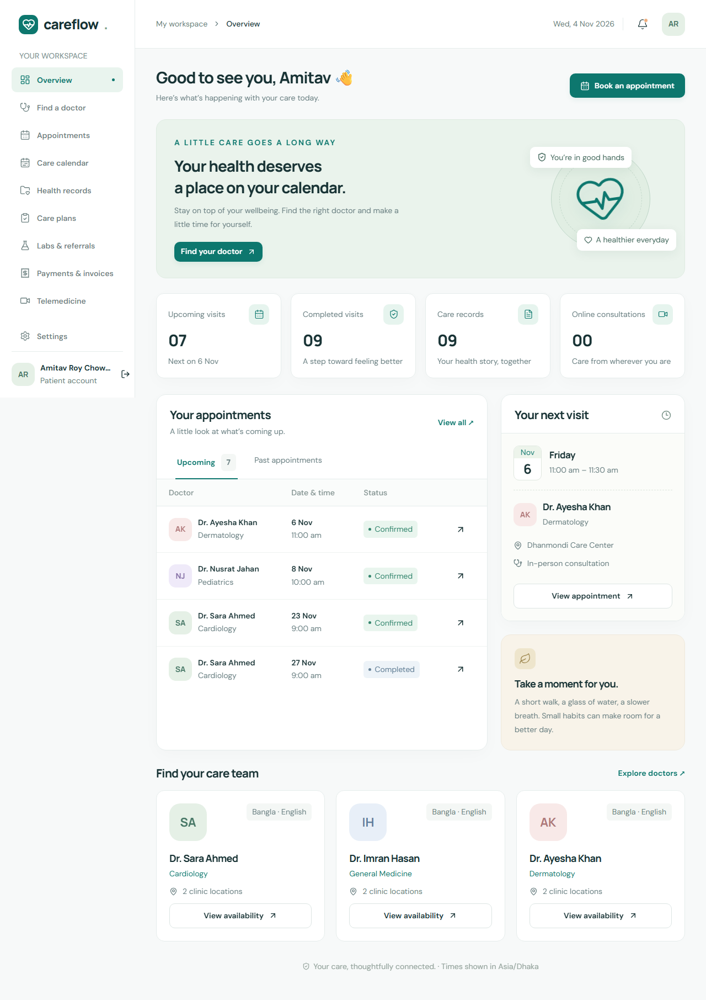
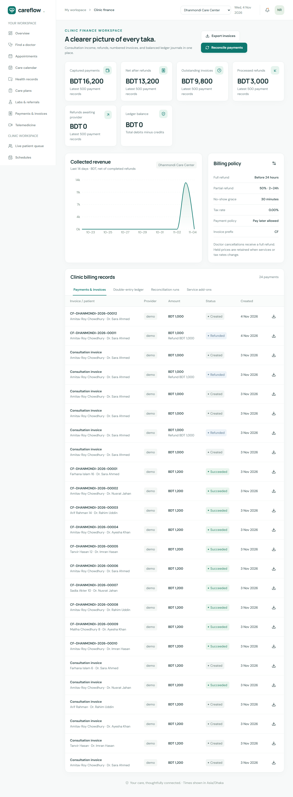

# Careflow frontend

Next.js App Router application with patient, doctor and clinic operations workspaces. All frontend configuration, browser tests, screenshots and dependencies live in this folder.



The application includes role-aware overviews, FullCalendar month/week/day views, a live clinic queue, recurring availability with impact previews, clinical templates, care plans, laboratory results, referrals, private consultation chat, finance and device/consent controls. Visible text starts at 14px. Layouts adapt to mobile, dialogs manage keyboard focus, and animations respect reduced-motion preferences.



```powershell
cd frontend
npm ci
npm run dev
```

Run the backend first using [its setup guide](../backend/README.md). The default web address is `http://localhost:3000`; `/api` is proxied to `API_INTERNAL_URL` (default `http://localhost:4000`). Never put server credentials in this app's environment files.

```powershell
npm run typecheck
npm run build
npm run start
npx playwright install chromium
npm run test:e2e
```

The build uses the official Webpack fallback so it also works on Windows systems where native SWC/Turbopack bindings are unavailable. Browser tests start the compiled web and backend applications if they are not already running. Build both projects before running them.

See [the original specification](../backend/docs/Project_spec.md) and [architecture](../backend/docs/architecture.md) for workflows and configuration. The repository intentionally has only two top-level application folders; each owns its package manifest and lockfile.
